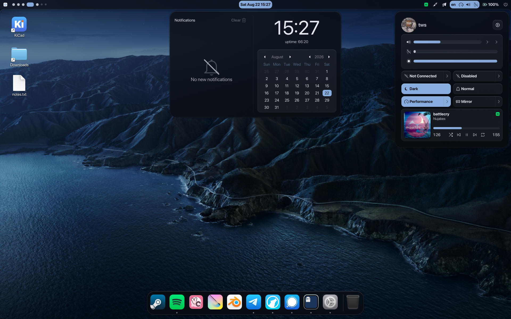

# scheme-desktop

A GTK4 Wayland desktop shell in Guile Scheme, built on
[Astal](https://github.com/aylur/astal) via scheme-toolkit.

## A quick word from our lack of sponsors...

This project has been moderately expensive to implement in its use of
AI, and I'm running out of money to do it. If you want to see it move
forward, money, AI tokens or human assistence would help it move
forward much faster. Having said that, look at whats been achieved by
one guy in a short time.

## Developer Discussion

Github forum is turned on above, you should feel free to discuss the
project there.

## Check out my other projects:

* [Hyprscheme - program Hyprland in scheme](https://github.com/xpusostomos/Hyprscheme)
* [Schemacs - Emacs in Scheme](https://github.com/xpusostomos/schemacs)
* [Scheme Terminal - terminal app programmable in Scheme](https://github.com/xpusostomos/scheme-terminal)
* [Guile scsh - a scheme shell with structured editing](https://github.com/xpusostomos/guile-scsh)

